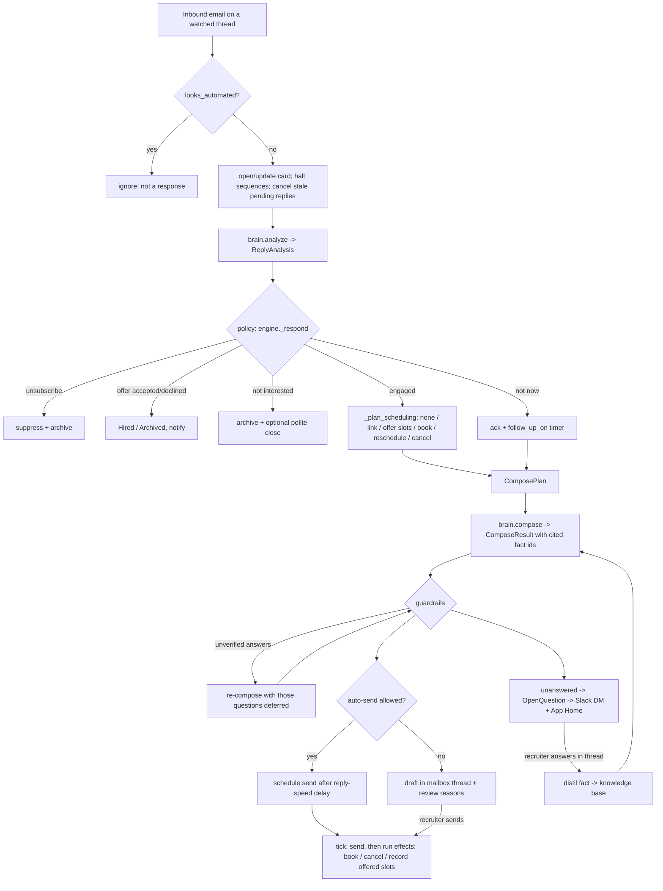

# Architecture of the clean-room implementation

## Design principles

1. **The model classifies and writes; code decides.** `ReplyAnalysis` is a closed schema, and
   every action is chosen by `engine.py` from enumerated settings. A prompt-injected email can
   at worst cause a wrong classification. It can't invoke an action that doesn't exist.
2. **Every factual answer cites knowledge-base fact ids.** `guardrails.unverified_answers`
   rejects:
   * citations that don't exist;
   * low-confidence claims;
   * questions the model silently skipped.

   Rejected questions are re-composed as "I'll check and get back to you" and escalated.
3. **Side effects follow the message, not the decision.** Booking, cancelling and recording
   offered slots are `Effect`s attached to the outbox item. They run only when the email
   actually goes out, whether that's an agent send after the delay or a recruiter sending the
   draft. Booking re-checks free/busy at send time; if the slot was taken, the agent apologises
   and re-offers.
4. **Anything uncertain becomes a draft.** Draft triggers:
   * drafts mode;
   * a degraded model (refusal, API error, truncation);
   * a sensitive topic or deal-breaker;
   * a guardrail hit (placeholder, invented figure, protected characteristic, offer language,
     confidential client name);
   * a recent human message in the thread;
   * the per-thread daily cap.
5. **Newest context wins.** A new candidate message cancels any pending reply or stale draft,
   and the agent re-plans from the full thread.

## Model usage (`brain/claude.py`)
* Two calls per turn: `analyze` at `effort=low` and `compose` at `effort=medium`, plus a
  low-effort `distill_fact` when learning.
* Default model `claude-opus-5-5`, structured outputs via `output_config.format` (JSON schema),
  and server-side refusal fallback (`fallbacks="default"`).
* Prompt caching: a frozen system prompt plus a per-job block (job description and knowledge
  base) marked `cache_control`; the volatile thread comes after it.
* Candidate text is fenced in `<candidate_email>` and `<thread>` and labelled untrusted.

## Production adapters to add
* `MailProvider`: Gmail (`users.drafts.create` / `users.messages.send` with `threadId` and
  `In-Reply-To`/`References`) or Microsoft Graph (`createReply` / `send`), plus push-based
  mailbox sync calling `handle_inbound`, `approve_draft` (when a draft we wrote is sent) and
  `record_human_reply`.
* `Calendar`: Google `freeBusy.query` + `events.insert`, or Graph `getSchedule` + `events`.
* `Store`: a database. `tick()` becomes a scheduled worker; outbox sends become a job queue.
* Slack: an Events API endpoint that verifies signatures (`verify_slack_signature`), extracts
  thread replies (`thread_reply_from_event`) and calls `on_slack_reply`.
